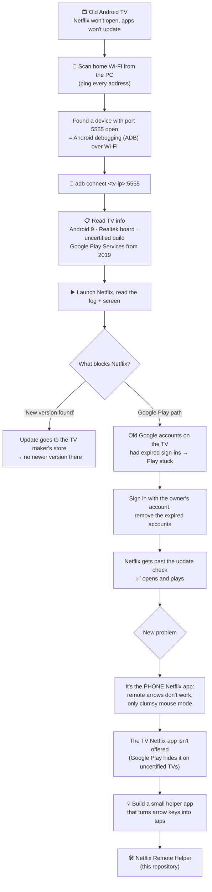
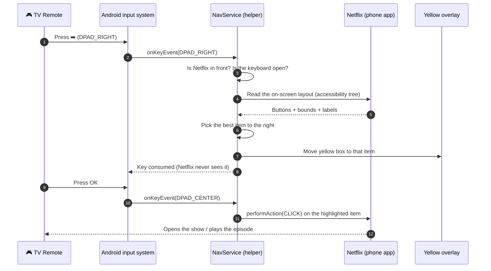
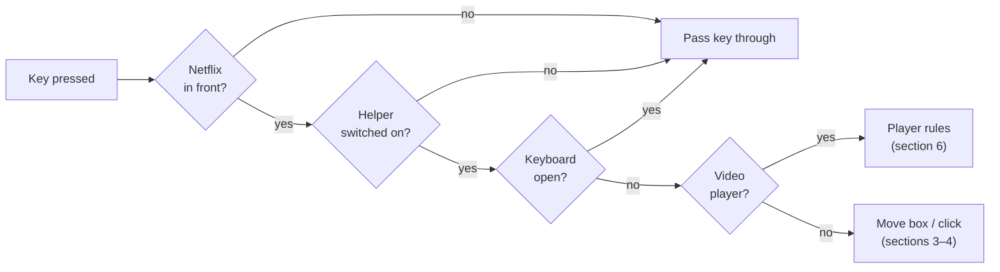
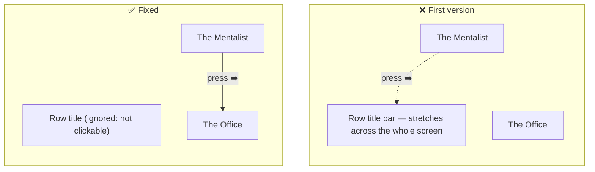
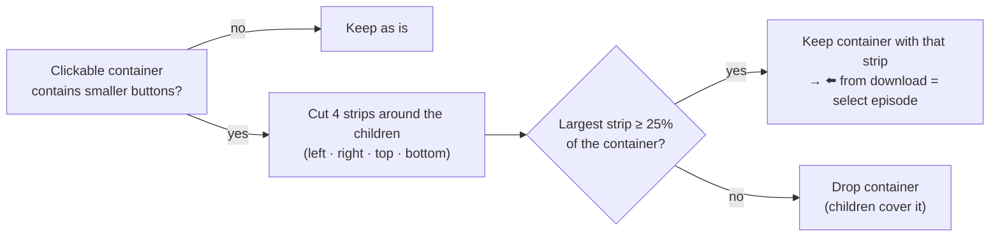
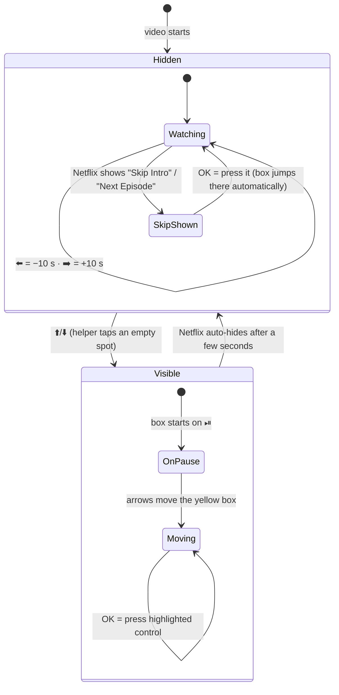
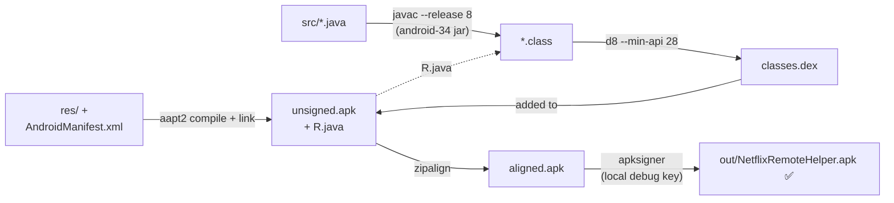
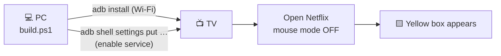

# Netflix TV Remote Helper

Use a normal TV remote with the **phone version of Netflix** on an old Android TV.

## 👥 Who is this for?

**This project is useful for you if:**

- 📺 You have an **older or budget Android TV / TV box**, especially a non-Google-certified one (generic Realtek, Amlogic or Allwinner boards, often sold under small or local brands), that **can't install or update the TV version of Netflix**.
- 📱 The only Netflix that works on your TV is the **phone/tablet app**, and you're stuck using a slow **"mouse mode" cursor** because the remote's arrow keys do nothing.
- 👵 Someone in your home (parents, grandparents, kids) finds **mouse mode too hard** and just wants the remote to work normally: arrows to move, OK to select.
- 💸 You'd rather **keep using the TV you have** than buy a streaming stick right away.
- 🛠 You're a **developer or tinkerer** curious how to make a touch-only Android app usable with a D-pad remote, using Android's accessibility API. The same idea works for other phone-only apps.
- 🔎 You're **troubleshooting an old Android TV** where apps "won't update" or Netflix won't open. Section 1 walks through the full diagnosis over Wi-Fi with ADB.

**This project is *not* for you if:**

- ✅ Your TV already has the **official Netflix TV app** (it shows the normal TV interface and the remote works). You don't need this.
- 🔥 You use a **certified device** such as a Chromecast with Google TV, Fire TV, Apple TV or a recent smart TV. Those already support the remote.
- 🏴‍☠️ You're looking for a way to bypass Netflix restrictions, DRM or region locks. This app does **none** of that. It only presses buttons for you, like a screen reader.

> **What you need:** an Android TV (Android 9 or newer) with the phone Netflix app installed, a PC, and the ability to enable ADB/USB debugging on the TV. For building it yourself: the Android SDK and JDK 17 (see [section 8](#8-building-the-apk-no-gradle)).

Some older, non-Google-certified Android TVs can only run the phone/tablet Netflix app. That app is built for touch screens. It ignores the remote's arrow keys, so the only way to use it is a slow "mouse mode" cursor.

This project is a tiny Android **accessibility service**. It listens to the remote's arrow and OK keys while Netflix is open. It draws a **yellow highlight box** around buttons and shows, moves the box with the arrows, and presses the highlighted item when you press OK. In the video player, OK pauses and resumes, and left and right skip 10 seconds.

> Not affiliated with or endorsed by Netflix. This app does not modify Netflix. It only reads the on-screen layout through Android's accessibility API, the same way screen readers do, and presses buttons for you.

---

## Contents

0. [Who is this for?](#-who-is-this-for)
1. [The story: from "Netflix won't open" to this app](#1-the-story-from-netflix-wont-open-to-this-app)
2. [How the helper works](#2-how-the-helper-works)
3. [Moving the highlight: spatial navigation](#3-moving-the-highlight-spatial-navigation)
4. [Buttons inside buttons](#4-buttons-inside-buttons)
5. [Typing: stepping aside for the keyboard](#5-typing-stepping-aside-for-the-keyboard)
6. [The video player](#6-the-video-player)
7. [Remote control cheat sheet](#7-remote-control-cheat-sheet)
8. [Building the APK (no Gradle)](#8-building-the-apk-no-gradle)
9. [Installing on the TV](#9-installing-on-the-tv)
10. [Debugging](#10-debugging)
11. [Limitations](#11-limitations)

---

## 1. The story: from "Netflix won't open" to this app

The TV connected to the internet, and YouTube worked, but Netflix and other apps would not open or update. Here is how the problem was tracked down, all over Wi-Fi from a PC, without touching the TV's software.



Things learned along the way:

| Finding | Why it mattered |
|---|---|
| Port **5555** open on the TV | ADB over Wi-Fi was already enabled, so the PC could inspect and control the TV with no cable. |
| Build fingerprint ends in `userdebug`, generic **Realtek** board | Not Google-certified. Google Play hides certified-only apps like the TV version of Netflix. |
| Installed app is `com.netflix.mediaclient`, the **phone** app | Built for touch, so the D-pad doesn't work. That's why the TV offered mouse mode. |
| Netflix sets **FLAG_SECURE** | Screenshots of Netflix come out black, so the screen layout was read with `uiautomator dump` instead. |
| Netflix exposes buttons to **accessibility** | The phone app is screen-reader friendly, so every button has bounds and a label. That made this helper possible. |

---

## 2. How the helper works

The helper is a single Android **AccessibilityService** (`NavService`). Android gives it two powers:

1. **Key filtering.** It sees remote key presses *before* the app does and can consume them.
2. **Window content.** It can read the tree of on-screen views (bounds, labels, clickable or not) and act on them by clicking, scrolling or performing gestures.



When the helper does **not** act, the key goes through untouched:
- Netflix isn't the app in front (other apps behave normally),
- the on-screen keyboard is open,
- the helper is switched off (Menu key or long-press OK),
- the key isn't an arrow or OK (Back, Home and volume always pass through).



---

## 3. Moving the highlight: spatial navigation

On every arrow press the helper:

1. **Collects candidates:** every visible, clickable item on screen. Row titles and huge full-screen containers are skipped.
2. **Filters by direction**, using the same rule Android TVs use internally (`FocusFinder`). For **right**, a candidate must actually start further right than the current item and end further right too.
3. **Scores** the remaining candidates and moves the box to the best one.

```
score = (in the same row/column ? 0 : 100,000,000)
      + 13 × (gap in the pressed direction)²
      + (offset sideways)²
```

The huge penalty means **items in the same row always win** over items above or below. That rule fixed the first real bug.



The bug: each Netflix row title is a thin bar spanning the whole width, sitting just above the shows. Its center is "to the right" of the first show and it's very close, so pressing right jumped **up** to the title. The fix was to ignore non-clickable titles and use the stricter Android direction rule plus the same-row preference.

**Reaching the edge:** if nothing is left in the pressed direction, the helper scrolls the nearest scrollable list (a carousel row for left/right, the page for up/down). It tries the accessibility scroll action first, then a swipe gesture if needed. Then it picks the next item.

---

## 4. Buttons inside buttons

On a show's episode list, Netflix makes each **whole episode row** one big button (tap = play the episode), with a small **download** button inside it.

```
┌──────────────────────── episode row (clickable: PLAY) ─────────────────────────┐
│ ┌────────────┐                                                       ┌──────┐ │
│ │ ▶ picture  │  1. Episode title                                     │  ⬇   │ │
│ └────────────┘  48 min                                               └──────┘ │
│ Episode description …                                         download button │
└─────────────────────────────────────────────────────────────────────────────────┘
```

An early version dropped any button that contained smaller buttons, so the episode itself could never be selected. The box was stuck on "download". Now the helper **keeps the big button but shrinks it to its largest free strip**, here the part left of the download button:



---

## 5. Typing: stepping aside for the keyboard

Search opens Android's on-screen keyboard, which is a **separate app** that already supports arrow keys. At first the helper kept grabbing the arrows, so they never reached the keyboard and it closed.

Now, if a keyboard window is on screen (`AccessibilityWindowInfo.TYPE_INPUT_METHOD`), the helper hides the yellow box and **passes every key through**. Close the keyboard with Back, or finish searching, and the box comes back.

---

## 6. The video player

The player has two states, and the helper treats them differently:



Why it isn't just "tap the middle": the pause button sits at the **exact center** of the screen. Tapping the center to "show controls" would pause the video whenever the controls were already visible. So the helper reveals controls by tapping an **empty spot** between the buttons and the progress bar, and only when they're hidden. It then presses the real button (pause, −10 s or +10 s) by its label.

Player controls found on the TV (Turkish Netflix interface):

| Control | Netflix label | Where |
|---|---|---|
| Back | `Yukarı git` | top-left |
| Rewind 10 s | `10 saniye geri` | left of center |
| Pause / Play | `Duraklat` / `Oynat` | **exact center** |
| Forward 10 s | `10 saniye ileri` | right of center |
| Bottom bar | Speed · Lock · Episodes · Audio & Subtitles · Next Episode | bottom |

**Skip Intro / Next Episode:** when one of these buttons appears while the controls are hidden, the yellow box jumps to it, and one OK presses it. The helper never presses anything on its own.

With controls visible and no current selection, the **first arrow or short OK only selects play/pause**; the next key navigates or clicks. With controls hidden, the reveal tap is **(640, 520)**, followed by a **350 ms** wait and a fresh tree scan before acting. A held left/right key that started hidden continues seeking after controls appear, limited to one click per **300 ms**; a hold started visible navigates normally. If controls do not appear, the helper drops the queued action rather than tapping blindly.

The bottom-bar Next Episode button at **y ≥ 640** is not an auto-selected skip prompt while controls are visible; it remains reachable with normal navigation. A disappearing skip prompt or auto-hidden control clears its highlight. Pending player actions are canceled on disable, keyboard opening, Netflix losing the active window, or a player-window change. At a player navigation edge, the highlight stays put rather than sending a browse-style swipe.

The recorded layout is 1280×720. A paused player is assumed to expose `Oynat` or `Play`; play/pause matching uses whole Turkish/English words and excludes next/skip descriptions. Real skip/recap/end-of-episode timing and OEM gesture behavior require device testing. MENU/INFO still toggle the helper even with the keyboard open; arrows and OK pass through to the keyboard.

---

## 7. Remote control cheat sheet

| Where | ⬆️ ⬇️ | ⬅️ ➡️ | OK | Hold OK / Menu |
|---|---|---|---|---|
| Browsing (home, search results, show page) | Move box between rows | Move box along a row, scrolling at the edge | Open / play the highlighted item | Turn helper off / on |
| Keyboard open | Keyboard handles all keys | ← | ← | ← |
| Player, controls hidden | Show controls, box on ⏯ | −10 s / +10 s (hold to keep going) | Pause / resume, or press **Skip Intro** if shown | Turn helper off / on |
| Player, controls showing | Move box | Move box | Press highlighted control | Turn helper off / on |
| Any other app | Normal | Normal | Normal | Normal |

---

## 8. Building the APK (no Gradle)

The app is plain Java with no libraries, so it builds straight from the Android SDK tools. No Gradle and no downloads are needed. `build.ps1` runs this pipeline:



**Requirements** (the paths are set at the top of `build.ps1`; edit them for your PC):
- PowerShell 7
- Android SDK with **platform android-34** and **build-tools 34.0.0**
- JDK 17 (Android Studio's bundled `jbr` works)

```powershell
pwsh -File .\build.ps1
```

On the first build, a local `debug.keystore` is generated to sign the APK. It's in `.gitignore`, so never commit it.

---

## 9. Installing on the TV

1. On the TV, enable **Developer options → USB/Network debugging**. Some TVs, like the one this was made for, already have network ADB open on port 5555.
2. From the PC:

```bash
adb connect <tv-ip>:5555
adb install -r out/NetflixRemoteHelper.apk
```

3. Turn the service on, either in **Settings → Accessibility → Netflix Remote Helper** or from the PC:

```bash
adb shell settings put secure enabled_accessibility_services com.tvnav.netflixremote/com.tvnav.netflixremote.NavService
adb shell settings put secure accessibility_enabled 1
```

4. Turn the remote's **mouse mode off** and open Netflix. The yellow box appears on the first item.



---

## 10. Debugging

The helper logs every decision with the tag `TvNav`:

```bash
adb logcat -s TvNav
```

You'll see the key pressed, how many candidates were found, which item was chosen (label and bounds), and scroll attempts. Netflix logs heavily and the TV's log buffer is small, so stream the log while you test instead of reading it afterwards.

To see what the helper "sees" on a screen (this works even though Netflix blocks screenshots):

```bash
adb shell uiautomator dump /sdcard/ui.xml
adb pull /sdcard/ui.xml
```

---

## 11. Limitations

- Built and tested against the **Turkish** Netflix phone app (labels like `Duraklat`, `10 saniye geri`). English labels are included as fallbacks; other languages may need their labels added.
- Netflix can change its layout in any update, so some screens may need tweaks.
- "Skip Intro" detection is based on Netflix's usual button names and wasn't captured live during development.
- Netflix's video and DRM quality on uncertified TVs is limited by Netflix, not by this app.
- The real fix for an old TV is a certified streaming stick. This app makes the phone app usable until then.

## Project layout

```
tvnav/
├── AndroidManifest.xml          # app + accessibility service declaration
├── build.ps1                    # Gradle-free build pipeline
├── res/
│   ├── drawable/                # launcher icon + TV banner
│   └── xml/nav_service_config.xml   # accessibility service capabilities
└── src/com/tvnav/netflixremote/
    ├── NavService.java          # all navigation / player logic
    └── MainActivity.java        # small status + "open Accessibility settings" screen
```

## License

MIT. See [LICENSE](LICENSE).
